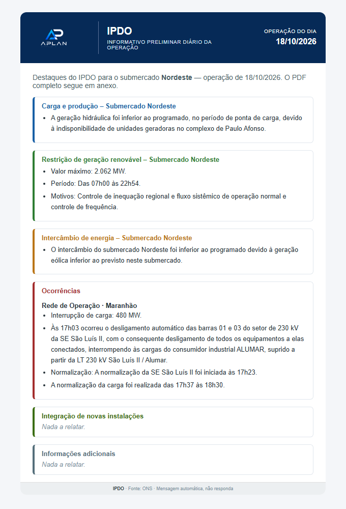

# IPDO Bot


Robô que lê todo dia o **IPDO** (Informativo Preliminar Diário da Operação, publicado pelo ONS) e manda por
e-mail os destaques do submercado **Nordeste** para a equipe de operação, com o PDF anexo.

## O problema

O IPDO é um PDF diário de várias páginas. A equipe só precisa de uma parte dele: carga, restrição de geração
renovável, intercâmbio e, principalmente, as **ocorrências** na rede do Nordeste.

O script que fazia isso antes procurava títulos que não existiam mais no PDF. Quando não achava nada, mandava
**"Nada a relatar"** — inclusive em dias com desligamentos reais. Ninguém percebia, porque o e-mail continuava
chegando todo dia, com cara de normal.

## A solução

Reescrevi o robô partindo de uma regra: **nunca dizer "Nada a relatar" sem o próprio PDF dizer isso.**

- **Leitura pela fonte do texto.** Os destaques do IPDO são escritos em *Courier New*; tabelas, títulos e
  rodapés, em *Arial*. O robô usa essa diferença para separar o texto que importa, em vez de depender de
  títulos que o ONS pode mudar.
- **Duas leituras que se conferem.** O PDF é lido de dois jeitos — só o texto em Courier e o texto inteiro
  filtrado — e as duas versões são comparadas.
- **Aviso em vez de silêncio.** Se as leituras discordam, se falta um dos 7 blocos esperados, se aparece um
  bloco novo ou se a data não é encontrada, o e-mail sai assim mesmo, mas com um aviso destacado:
  *"confira o PDF anexo"*.
- **Data certa.** O e-mail usa a data da operação (do cabeçalho do PDF), não a do nome do arquivo.
- **Resiliência.** Roda duas vezes por dia: a segunda só age se a primeira não conseguiu enviar (PDF ainda não
  publicado, site do ONS fora, SMTP fora). Se a segunda também falhar, manda um e-mail de falha.

## O resultado



*E-mail gerado a partir do IPDO real de 19/10/2026 (operação de 18/10), incluído nos testes.*

## Como funciona

```
ONS (PDF do dia) ──► download com novas tentativas
                       │
                       ├──► Google Drive (opcional, via Apps Script)
                       ▼
                 extração pela fonte  ◄──conferência──►  extração pelo texto
                       │
                       ▼
            seções do Nordeste + avisos ──► e-mail HTML + texto simples + PDF anexo
```

| Arquivo | O que faz |
|---|---|
| `ipdo/extracao.py` | Lê a seção "4 - Destaques da Operação" dos dois jeitos, compara e monta as seções e os avisos |
| `ipdo/email_ipdo.py` | Monta o e-mail (HTML com tabelas, compatível com Gmail e Outlook, e versão em texto) e envia por SMTP |
| `ipdo/execucao.py` | A rodada do dia: baixa, guarda no Drive, extrai, envia e registra o que já foi enviado |
| `ipdo/config.py` | Lê a configuração de arquivos `.env` — nenhuma senha no código |
| `main.py` | Linha de comando |

## Testes

```sh
python -m venv .venv
.venv/Scripts/python -m pip install -r requirements-dev.txt   # Linux/Mac: .venv/bin/python
.venv/Scripts/python -m pytest -q
```

`tests/fixtures/` tem **11 IPDOs reais** (maio a outubro de 2026), publicados pelo ONS. Os testes cobrem a
extração de cada um, a conferência entre as duas leituras, os avisos de formato, a montagem do e-mail, o
envio (com SMTP simulado) e as regras de reenvio e de falha. Quando o ONS muda o formato, o caminho é:
salvar o PDF novo em `tests/fixtures/`, escrever o teste que falha e só então mudar a extração.

## Como usar

1. Copie `.env.example` para `.env` e preencha (SMTP, destinatários).
2. Rode:

```sh
python main.py --data 19-10-2026 --previa previa.html   # só gera o HTML, não envia nada
python main.py --data 19-10-2026                        # envia o IPDO desse dia
python main.py --se-pendente                            # IPDO de ontem, se ainda não foi enviado
python main.py --se-pendente --alertar-falha            # última tentativa do dia: avisa se não der
```

Em produção roda num servidor Linux pelo cron, duas vezes por dia:

```
0 11 * * * cd /caminho/ipdo-bot && python main.py --se-pendente >> logs/ipdo.log 2>&1
0 13 * * * cd /caminho/ipdo-bot && python main.py --se-pendente --alertar-falha >> logs/ipdo.log 2>&1
```

## Tecnologias

Python 3.11 · pypdf · requests · smtplib · pytest · GitHub Actions · cron

---

Fonte dos dados: [ONS — Operador Nacional do Sistema Elétrico](https://www.ons.org.br), documentos públicos
do Acervo Digital. Projeto pessoal, sem vínculo com o ONS.
